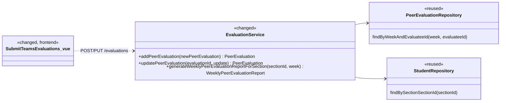

# Peer Evaluation (EVA) Design

> Realizes (in part): UC-EVA-submit-evaluation (extension 9a and the active-team-member scope), UC-EVA-section-evaluation-report (the deactivated-student listing rule)
> Depends on: BR-no-evaluation-of-inactive, BR-student-lifecycle, BR-evaluation-editable-until-close, BR-submission-owed, BR-team-assignment-required
> See: [use cases](../requirements/use-cases.md#peer-evaluation), [stu.md](stu.md) (deactivating a student), [architectural-design.md](architectural-design.md#performance-tracking-components) (performance-tracking component view)
> Designed against `main` at `59f0267` (2026-11-07). **Partial area doc:** it covers only what deactivating a student changes in peer evaluations. The rest of the EVA area was built before `/design` and is not yet captured here; extend this doc in place when another EVA use case is designed.

## Overview

The `evaluation` slice is a performance-tracking feature ([component view](architectural-design.md#performance-tracking-components)). Deactivating a student ([stu.md](stu.md)) changes two of its flows. A new peer evaluation of a deactivated student is rejected (BR-no-evaluation-of-inactive), so the submit page stops offering her. The course-section report lists her only for weeks in which she was evaluated, so her record before withdrawal stays and the weeks after it do not show a grade of 0. Evaluations written before she was deactivated are untouched and stay editable until their window closes.

## Components & classes



- [`EvaluationService`](../../backend/src/main/java/team/projectpulse/evaluation/EvaluationService.java): `addPeerEvaluation` gains the deactivated-evaluatee check, and `generateWeeklyPeerEvaluationReportForSection` gains the listing rule. `updatePeerEvaluation` is unchanged and is listed only because the decision below depends on it.
- [`SubmitTeamsEvaluations.vue`](../../frontend/src/pages/evaluations/SubmitTeamsEvaluations.vue): changed in three ways.
  - It lists a teammate when her account is active (`enabled` is already in the teammate `StudentDto` from `GET /students/teams/{teamId}`) or when the evaluator already has a saved evaluation of her for the week. A deactivated teammate with no saved evaluation is not listed.
  - Saving sends one request per listed teammate and waits for all of them to settle rather than stopping at the first failure: `PUT` for a teammate who already has a saved evaluation, `POST` for one who does not. Today the page sends `POST` for everyone or `PUT` for everyone, which after a partial save would leave the unsaved teammates unreachable.
  - If any request fails, it shows the failure and reloads its teammates and evaluations.
  - Whether it offers Submit or Update, and shows the not-submitted reminder, is derived from the listed rows (any without a saved evaluation), because a reload after a partial save can change it.
- No new class, controller, route, or exception: the rejection reuses `PeerEvaluationIllegalArgumentException` (`400` / `INVALID_ARGUMENT`).

## Sequence

### UC-EVA-submit-evaluation: extension 9a, a deactivated team member

```mermaid
sequenceDiagram
    actor E as Student (evaluator)
    participant P as SubmitTeamsEvaluations.vue
    participant C as EvaluationController
    participant S as EvaluationService
    participant R as PeerEvaluationRepository
    P->>P: load teammates; list the active ones and any with a saved evaluation (step 2)
    E->>P: evaluate each active team member and confirm (steps 4-8)
    loop one request per listed teammate, all sent: POST if unsaved, PUT if saved
        P->>C: addPeerEvaluation
        C->>S: addPeerEvaluation
        S->>S: open window (BR-active-weeks, BR-evaluation-submission-window)
        S->>S: evaluator on a team; evaluatee on the same team
        alt evaluatee deactivated since the page loaded (9a)
            S-->>C: PeerEvaluationIllegalArgumentException
            C-->>P: 400 "This teammate's account is deactivated and can no longer be evaluated."
        else evaluatee active
            S->>S: not a duplicate
            S->>R: save
            C-->>P: 200
        end
    end
    alt any request returned 400 (9a1)
        P->>E: show the message
        P->>P: reload (9a2: back to step 2, without her; the saved evaluations now go as PUT)
    else all saved
        P->>E: "Peer evaluations submitted successfully" (step 9)
    end
```

The evaluatee check runs after the team checks and before the duplicate check, so a student who names a deactivated teammate is told why, not that she evaluated her already.

## API contract

| Endpoint or job | Caller (who may) | Request | Success | Errors, by extension |
|---|---|---|---|---|
| `POST /api/v1/evaluations` (changed) | Unchanged: any authenticated caller at the route; the service requires the evaluator to be a student on the evaluatee's team | Unchanged | Unchanged | **9a** the evaluatee's account is deactivated: `400` / `INVALID_ARGUMENT`, message "This teammate's account is deactivated and can no longer be evaluated.", nothing saved. Existing errors unchanged |
| `PUT /api/v1/evaluations/{evaluationId}` | Unchanged | Unchanged | Unchanged: an evaluation of a student written before she was deactivated stays editable until its window closes | Unchanged |
| `GET /api/v1/evaluations/sections/{sectionId}/week/{week}` (changed) | Unchanged (`sectionInstructorAuthorizationManager`) | Unchanged | A student is listed when she is on a team (the existing condition, unchanged) **and**, new, either her account is active or she received at least one peer evaluation for `week` | Unchanged |

## Key decisions

**The rule blocks new evaluations, not edits.** `addPeerEvaluation` rejects a deactivated evaluatee; `updatePeerEvaluation` does not check. This is BR-no-evaluation-of-inactive as written, and it agrees with BR-evaluation-editable-until-close: an evaluation that existed before the deactivation keeps its normal lifecycle. Rejected: also blocking edits. The submit page's update mode re-sends every evaluation the student wrote that week, so one deactivated teammate would make the whole update fail.

**The service enforces the rule; the page only hides her.** The submit page leaves deactivated teammates out of a new submission so the common case never meets the error, and the service is what guarantees the rule. Rejected: hiding her in the UI alone, which a direct API call, or a deactivation while the form is open, would get around.

**Reload on rejection rather than roll back.** The page sends one `POST` per evaluatee, so when 9a happens, the evaluations of the other teammates are already saved. The page reports the message and reloads, and finds those evaluations in update mode, without her. Rejected: a batch endpoint that saves all or none, which would change the submission contract of a built use case for a rare race.

**The report's listing rule reads the current flag and the week's evaluations.** A deactivated student is listed for a week only if she received an evaluation that week. Since BR-no-evaluation-of-inactive stops new evaluations, that is in effect the weeks before her deactivation. Rejected: storing a deactivation date and listing her for weeks before it. That needs a schema change, and it would still show a 0 for an earlier week in which nobody evaluated her, which this rule hides along with the later weeks. Accepted consequence: a week before her deactivation in which nobody evaluated her drops her row. A reactivated student is active again, so she is listed in every week, as before.

**Who owes is not part of this report.** The "has not submitted" list on the report page comes from `GET /sections/{sectionId}/submission-status` ([not.md](not.md)), which already counts only active accounts (BR-submission-owed). This design does not touch it.

## Data model

No delta. The rules read `PeerEvaluationUser.enabled` and the existing `PeerEvaluation` rows (`findByWeekAndEvaluateeId`), as the SRS's [Business Domain Model](../requirements/software-requirements-specification.md#business-domain-model) defines them.

## Reuse & cross-cutting

- Deactivation itself, and the active-account check that stops a deactivated student's own requests: [stu.md](stu.md).
- Owing: BR-submission-owed through `SubmissionStatusService` ([not.md](not.md)), unchanged.
- Error envelope: `PeerEvaluationIllegalArgumentException` → `400` / `INVALID_ARGUMENT` through `ExceptionHandlerAdvice`, unchanged.

## Tests

| Use case, flow | Level | Asserts |
|---|---|---|
| UC-EVA-submit-evaluation 9a, service | unit | `addPeerEvaluation` with a deactivated evaluatee on the evaluator's team throws `PeerEvaluationIllegalArgumentException` with the message, and nothing is saved |
| UC-EVA-submit-evaluation 9a, route | integration | A student's `POST /evaluations` for a deactivated teammate, in an open window, returns `400` with the message, and no evaluation of her exists for that week |
| BR-no-evaluation-of-inactive, kept and editable | integration | An evaluation of a student written before she is deactivated is still returned by `GET /evaluations/evaluators/{evaluatorId}/week/{week}`, and its evaluator's `PUT` while the window is open returns `200` |
| UC-EVA-submit-evaluation step 2 | E2E (Cypress, API stubbed) | A deactivated teammate with no saved evaluation is not listed; one with a saved evaluation (written before she was deactivated) is listed, and her evaluation is sent as a `PUT` |
| UC-EVA-submit-evaluation 9a, page | E2E (Cypress, API stubbed) | When one of three `POST`s returns the 9a `400`, the other two are still sent; the page shows the message and reloads; the deactivated teammate is no longer listed, and the next save sends `PUT`s for the two saved evaluations |
| UC-EVA-submit-evaluation, partial save | E2E (Cypress, API stubbed) | With a saved evaluation for one active teammate and none for another, saving sends a `PUT` for the first and a `POST` for the second |
| UC-EVA-submit-evaluation main, unchanged | integration | Existing `EvaluationIntegrationTest.testStudentJohnAddEvaluation` and the `EvaluationServiceTest` extension tests still pass |
| UC-EVA-section-evaluation-report, past week | integration | A deactivated student who received at least one peer evaluation for the week is listed with her grade |
| UC-EVA-section-evaluation-report, later week | integration | For a week in which a deactivated student received no peer evaluation, she is not listed, and an active student with no evaluations is still listed at 0.0 |
| UC-EVA-section-evaluation-report, unchanged | integration | Existing `testAdminBingyangGenerateWeeklyPeerEvaluationForSection` and `testAdminTimGenerateWeeklyPeerEvaluationForSection` still pass |

## Open questions / risks

- **Other reports still list a deactivated student every week.** UC-EVA-student-evaluation-report and UC-EVA-view-own-evaluation compute one row per week for a named student and show 0 for weeks with no evaluations. The listing rule is specified only for the course-section report. Revisit if instructors find the per-student report misleading.
- **A reactivated student's withdrawn weeks show 0 again** in the course-section report, because the rule reads the current flag. That belongs to UC-STU-reactivate-student's design, together with its Open Issue on owing.
