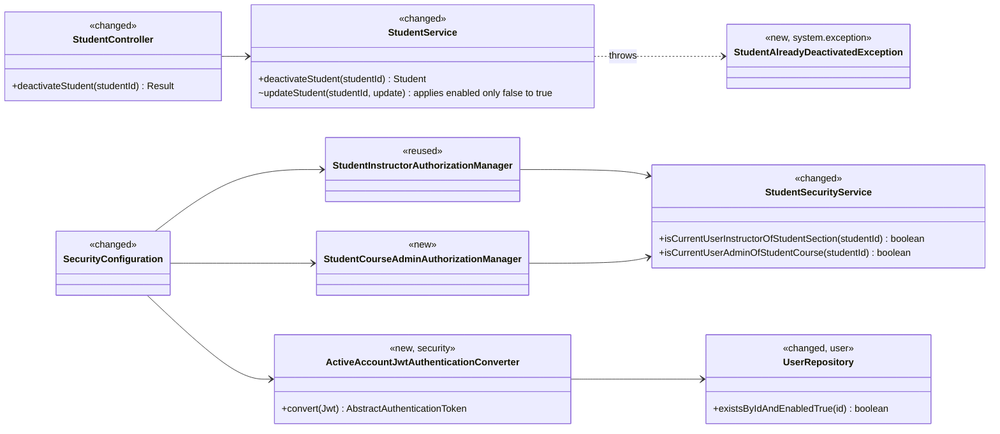

# Student (STU) Design

> Realizes: UC-STU-deactivate-student
> Depends on: FR-SEC-active-account, BR-student-lifecycle, BR-no-evaluation-of-inactive, BR-submission-owed, BR-section-scoped-access, BR-role-based-access, CO-ferpa
> See: [use cases](../requirements/use-cases.md#student), [SRS security requirements](../requirements/software-requirements-specification.md#security-and-authorization-requirements), [architectural-design.md](architectural-design.md#shared-foundation-components) (shared foundation component view, Security & Compliance), [eva.md](eva.md) (what deactivation changes in peer evaluations)
> Designed against `main` at `59f0267` (2026-11-07). The rest of the STU area was built before `/design` and is not yet captured here.

## Overview

The `student` slice is part of the shared foundation ([component view](architectural-design.md#shared-foundation-components)). This design adds the one way to deactivate a student: a dedicated action on the student's details page, with the use case's warning and confirmation, backed by its own route. Deactivation sets `PeerEvaluationUser.enabled` to false. Nothing is deleted, and the student stays on her team.

Two cross-cutting pieces make the consequence true. First, `security` checks on every request that the caller's account is still active, so a student who is already logged in is cut off on her next request rather than when her 2-hour token expires (FR-SEC-active-account). Second, `evaluation` rejects new peer evaluations of her and stops listing her in weeks she was not evaluated ([eva.md](eva.md)).

Before this design, the only way to deactivate a student was the Status switch in the Edit dialog, saved through the generic `PUT /students/{studentId}` with no warning, and the `enabled` flag was checked only at login.

## Components & classes



Backend:
- [`StudentController`](../../backend/src/main/java/team/projectpulse/student/StudentController.java), [`StudentService`](../../backend/src/main/java/team/projectpulse/student/StudentService.java), [`StudentSecurityService`](../../backend/src/main/java/team/projectpulse/student/StudentSecurityService.java): changed.
- [`StudentInstructorAuthorizationManager`](../../backend/src/main/java/team/projectpulse/security/authorizationmanagers/StudentInstructorAuthorizationManager.java): reused. It passes when the caller's id is among `student.section.instructors`, so a student (whose id is never there) and an instructor of another course section fail, and an instructor assigned to several course sections passes for each. `StudentCourseAdminAuthorizationManager`: new, in the same package; it reads `studentId` and fails closed like its siblings.
- `ActiveAccountJwtAuthenticationConverter`: new, in `security`. It wraps the existing `jwtAuthenticationConverter()` bean in [`SecurityConfiguration`](../../backend/src/main/java/team/projectpulse/security/SecurityConfiguration.java), keeps its authority mapping, and reads [`UserRepository`](../../backend/src/main/java/team/projectpulse/user/UserRepository.java) through a new `existsByIdAndEnabledTrue`. Both packages are in the foundation, so the dependency is allowed (`MNT-feature-locality`).
- `StudentAlreadyDeactivatedException`: new, in `system/exception`, mapped by `ExceptionHandlerAdvice` to `409` / `StatusCode.CONFLICT` (the code already exists; only the handler is new).

Frontend:
- [`apis/student`](../../frontend/src/apis/student/index.ts): new `deactivateStudent(id)`.
- [`StudentPerformanceDashboard.vue`](../../frontend/src/pages/students/StudentPerformanceDashboard.vue), the details page UC-STU-view-student opens: changed. It shows a Status tag next to the student's name and a Deactivate button while she is active, which opens an `ElMessageBox` confirmation.
- [`EditStudentForm.vue`](../../frontend/src/pages/students/EditStudentForm.vue): changed. The Status switch is shown only for a deactivated student, as the interim reactivate path recorded in UC-STU-reactivate-student.

## Sequence

### UC-STU-deactivate-student: main success scenario

```mermaid
sequenceDiagram
    actor U as Course admin or instructor
    participant P as StudentPerformanceDashboard.vue
    participant A as apis/student
    participant F as security filter chain
    participant C as StudentController
    participant S as StudentService
    participant R as StudentRepository
    U->>P: open the student's details (step 2, UC-STU-view-student)
    U->>P: Deactivate (step 3; shown only while she is active)
    P->>U: confirmation naming the consequences (step 4)
    alt Cancel (5a)
        U->>P: Cancel
        Note over P: no request is sent
    else Confirm (step 5)
        U->>P: Confirm
        P->>A: deactivateStudent(id)
        A->>F: POST /api/v1/students/{id}/deactivation
        F->>F: verify JWT; caller's account still active
        F->>F: anyOf(StudentInstructor, StudentCourseAdmin)
        alt neither (3a)
            F-->>P: 403
        else allowed
            F->>C: deactivateStudent(id)
            C->>S: deactivateStudent(id)
            S->>R: findById(id)
            alt already deactivated (6a)
                S-->>C: StudentAlreadyDeactivatedException
                C-->>P: 409 "This student is already deactivated."
                P->>U: message; Status tag reloads as Deactivated
            else active
                S->>R: save(enabled = false)
                C-->>P: 200 StudentDto (enabled false)
                P->>U: "Student deactivated"; Status tag shows Deactivated (step 6)
            end
        end
    end
```

The confirmation (step 4) names each consequence in the use case's Associated Information, worded: "Deactivate {first name} {last name}? They will no longer be able to log in or submit weekly activity reports and peer evaluations, and a session they have open ends on its next request. Their account and submitted work are kept, they stay on their team, and they can be reactivated later." Confirm and Cancel are the two buttons.

On `200` the page shows its own toast, "Student deactivated." (the envelope's "Deactivate student successfully" is not shown), and re-fetches the student. On `409` (6a) the shared Axios instance already toasts the envelope's message, so the page adds no message of its own; it re-fetches the student, so the tag shows Deactivated and the button disappears. On `403` the shared instance routes to the forbidden page, as it does for every route.

**Where 3a is refused.** The use case denies at step 3; the design refuses at the `POST`, after the warning. In the UI the two coincide: the details page is reachable only through `GET /students/{studentId}`, which today admits only the student herself and her assigned instructors; the router keeps students off the page; and every assigned instructor may deactivate. So a `403` after the warning arises only from a direct API call, or if OI-65 is fixed by widening the view route without also widening who sees the button.

### FR-SEC-active-account: a deactivated student's open session

```mermaid
sequenceDiagram
    actor St as Deactivated student
    participant SPA
    participant F as security filter chain
    participant AC as ActiveAccountJwtAuthenticationConverter
    participant UR as UserRepository
    St->>SPA: submit a weekly activity report
    SPA->>F: POST /api/v1/activities (Bearer JWT, not yet expired)
    F->>F: verify signature and expiry
    F->>AC: convert(jwt)
    AC->>UR: existsByIdAndEnabledTrue(userId claim)
    UR-->>AC: false (disabled, or no row)
    AC-->>F: DisabledException
    F-->>SPA: 401 "User account is abnormal." (entry point → ExceptionHandlerAdvice)
    SPA->>SPA: clear token and user stores; redirect to login
    St->>SPA: log in again
    SPA->>F: POST /api/v1/users/login
    F-->>SPA: 401 (login already refuses a disabled account)
```

## API contract

| Endpoint or job | Caller (who may) | Request | Success | Errors, by extension |
|---|---|---|---|---|
| `POST /api/v1/students/{studentId}/deactivation` | An instructor assigned to the student's course section, or the course admin who owns its course (BR-student-lifecycle): `AuthorizationManagers.anyOf(studentInstructorAuthorizationManager, studentCourseAdminAuthorizationManager)`; the route rule goes with the other `/students/**` rules, before the `denyAll()` catch-all | Path `studentId`; no body | `200`, message "Deactivate student successfully", `StudentDto` with `enabled: false` | **3a** a student (herself included), an instructor not assigned to her course section, a course admin of another course, or an id that names no student: `403` (the managers fail closed and do not reveal which ids exist). **6a** already deactivated: `409` / `CONFLICT`, message "This student is already deactivated.", no change |
| `PUT /api/v1/students/{studentId}` (changed) | Unchanged | Unchanged | Unchanged, except that `enabled` is applied only when a `ROLE_instructor` caller changes it from false to true. A `false` for an active student is ignored, as the route already ignores `roles` | Unchanged |
| Every request carrying a Bearer JWT (changed) | — | — | Unchanged while the account named by `userId` exists and is enabled | Deactivated or deleted account: `401` / `UNAUTHORIZED`, message "User account is abnormal." |

## Key decisions

**A dedicated action route, not a field write.** Deactivation is `POST /students/{studentId}/deactivation`. Rejected: `PATCH /students/{studentId}` with `{ enabled: false }`, which keeps deactivation a field write and so reopens the path that skips the confirmation, and which turns "already deactivated" into an awkward no-op instead of a conflict (6a). UC-STU-reactivate-student will add the sibling `POST /students/{studentId}/reactivation`.

**The generic update keeps only false to true, as an interim reactivate path.** `StudentService.updateStudent` applies `enabled` only when an instructor turns it on, so deactivation goes only through the new route, with its warning and confirmation. The Edit dialog shows the switch only for a deactivated student. Recorded in UC-STU-reactivate-student's Associated Information, to be replaced when that use case is built. A `false` sent for an active student is ignored. Rejected: answering it with `400`, since the only client never sends it once the switch is hidden. Rejected: removing the `enabled` write altogether, which would leave reactivation with no UI until UC-STU-reactivate-student is built.

**The active-account check is in the JWT converter, on every request.** `ActiveAccountJwtAuthenticationConverter` asks `UserRepository.existsByIdAndEnabledTrue` about the user named by the `userId` claim and throws `DisabledException` when the account is disabled or missing, or the claim is absent. It covers every route, for students and instructors alike, which is what FR-SEC-active-account requires, and it also locks out a deleted account's token. The cost is one primary-key read per request. The check is an existence query, not a `findById`, because loading the user would also load a student's mandatory, eagerly fetched course section on every request, and the check needs only the flag. Rejected:
- an in-memory token blocklist: it is per-instance, and every place that disables an account would have to populate it;
- checks inside the activity and evaluation services: they miss reads and every future route;
- caching the flag: it reopens the staleness window the check exists to close;
- shortening the token's lifetime: it narrows the window without closing it, and makes everyone log in more often.

The architecture-of-record's [Authentication](architectural-design.md#authentication) section and its runtime authentication sequence record the check.

**Authorization follows BR-student-lifecycle, not the generic user route.** The route composes the existing student-instructor manager with a new course-admin manager, the same `anyOf` pattern [not.md](not.md) uses. `isCurrentUserAdminOfStudentCourse` compares the caller with `student.section.course.courseAdmin`. Rejected: `userOwnershipAuthorizationManager`, which admits the student herself and denies a course admin not assigned to the course section.

**The action is on the details page.** Step 2 reaches the student through UC-STU-view-student, so the Deactivate button sits on `StudentPerformanceDashboard.vue`. Rejected: a button in the `Students.vue` Operations column, which skips the details step and puts an unrecoverable-sounding action one click from a list row.

**Deactivation touches only the flag.** The student keeps her team, her weekly activity reports, and her peer evaluations. Owing is already handled: BR-submission-owed counts only active accounts, and `SubmissionStatusService` reads `enabled`, so she stops owing, and stops being owed, the moment the flag changes. Rejected: removing her from her team, which would hide her past work from team views and need undoing on reactivation.

## Data model

No delta. `PeerEvaluationUser.enabled` already exists, and deactivation writes only that column. The SRS's [Business Domain Model](../requirements/software-requirements-specification.md#business-domain-model) is unchanged.

## Reuse & cross-cutting

- Authentication: the Spring Security resource server and the existing `CustomBearerTokenAuthenticationEntryPoint`, which hands the converter's `DisabledException` to `ExceptionHandlerAdvice` (`AccountStatusException` → `401`). The SPA's shared Axios instance already clears the token and redirects to login on `401`.
- Authorization: `StudentInstructorAuthorizationManager`, plus the new course-admin manager, composed with `AuthorizationManagers.anyOf`.
- Owing: BR-submission-owed through `SubmissionStatusService` ([not.md](not.md)), unchanged.
- Peer evaluations: BR-no-evaluation-of-inactive and the section report's listing rule, designed in [eva.md](eva.md).
- Error envelope: `Result` via `ExceptionHandlerAdvice`, with one new `409` mapping.

## Tests

| Use case, flow | Level | Asserts |
|---|---|---|
| UC-STU-deactivate-student main, assigned instructor | integration | An instructor assigned to the student's course section gets `200` and `enabled: false` from `POST …/deactivation`; a later `GET /students/{id}` shows her deactivated; her weekly activity reports and peer evaluations are all still there |
| UC-STU-deactivate-student main, course admin | integration | The course admin who owns the course but is not assigned to the course section gets `200` |
| UC-STU-deactivate-student 3a | integration | The student herself, another student, an instructor not assigned to her course section, a course admin of another course, and an id that names no student each get `403` with the `Result` envelope, and the student's account is unchanged |
| UC-STU-deactivate-student 5a | E2E (Cypress, API stubbed) | Cancelling the confirmation sends no `POST` |
| UC-STU-deactivate-student step 4 | E2E (Cypress, API stubbed) | The confirmation shows the wording above, including the open-session sentence; Confirm sends one `POST`, and the page then shows "Student deactivated." and the Deactivated tag |
| UC-STU-deactivate-student 6a | integration | Deactivating an already-deactivated student returns `409` with the message, and she stays deactivated |
| UC-STU-deactivate-student 6a, page | E2E (Cypress, API stubbed) | On a `409` the page re-fetches the student and shows the Deactivated tag with no Deactivate button |
| UC-STU-deactivate-student, button visibility | E2E (Cypress, API stubbed) | Deactivate shows for an active student and not for a deactivated one; the Edit dialog's Status switch shows only for a deactivated student |
| UC-STU-deactivate-student, open session (FR-SEC-active-account) | integration | A token the student got before she was deactivated returns `401` on `GET /students/{her id}` and on `POST /activities`, and no activity is created |
| UC-STU-deactivate-student, login | integration | Logging in with her credentials after deactivation returns `401` |
| UC-STU-deactivate-student, team kept | integration | After deactivation she still appears in `GET /students/teams/{teamId}` with `enabled: false`, and `GET /sections/{sectionId}/submission-status` does not list her as owing |
| FR-SEC-active-account, instructor | integration | A deactivated instructor's unexpired token returns `401` |
| FR-SEC-active-account, converter | unit | An enabled user yields an authentication carrying the token's authorities; a disabled user or a missing row throws `DisabledException` |
| Generic update cannot deactivate | integration | An assigned instructor's `PUT /students/{id}` with `enabled: false` for an active student returns `200`, and she stays active |
| Interim reactivate path | integration | An assigned instructor's `PUT /students/{id}` with `enabled: true` for a deactivated student activates her; a student's own `PUT` still cannot change `enabled` (`testStudentJohnUpdatesOwnInfo`, kept) |

Test data: each test that needs a deactivated student deactivates a seeded one itself (through the route, or the repository for service tests), and the class resets the database afterward, as the existing integration tests do. `DataInitializer` gains no deactivated student, because one would change rows, counts, and owing lists that existing tests assert.

The peer-evaluation consequences (BR-no-evaluation-of-inactive, the section report) are tested in [eva.md](eva.md#tests).

## Open questions / risks

- **A course admin not assigned to the course section cannot reach step 2.** The new route admits her, but UC-STU-view-student's route and the student search are scoped to assigned instructors, so the UI gives her no way to the Deactivate button. Logged as OI-65, because fixing it changes another use case's access rule.
- **The interim reactivate path inherits the generic update's guard**, so that same course admin cannot reactivate either, and the interim path sends no notification. Both are UC-STU-reactivate-student's to fix.
- **A student deleted while her details page is open** gets `403` from the route rather than a not-found message, because the managers fail closed. Accepted: it is a rare race, and failing closed is the convention.
- **One extra read per request.** At course scale, about 100 users, a primary-key read is negligible. Revisit only if request volume grows by orders of magnitude.
